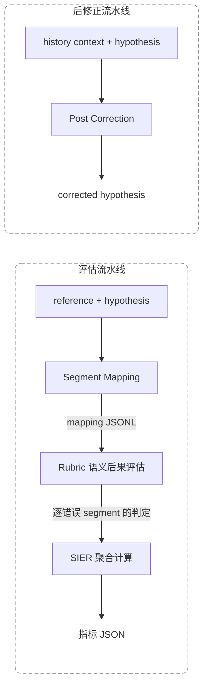
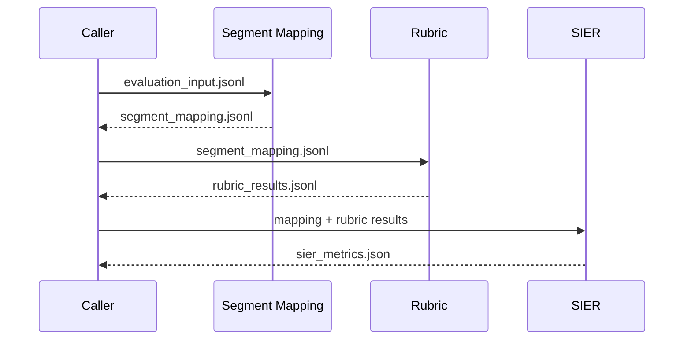
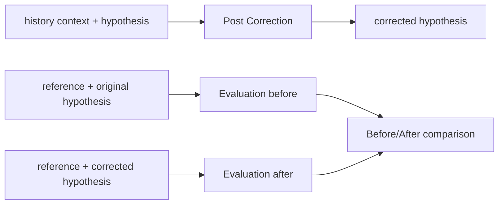

# Smart Pipeline

Smart Pipeline 将现有的 ASR segment mapping、rubric 语义后果评估、SIER 指标计算和 ASR 后修正代码整理到同一个仓库中。

原项目中的实现保持不变；四个根目录脚本作为适配层提供统一的外部接口。

## 目录结构

```text
smart-pipeline/
├── segment_mapping/       # reference/hypothesis 对齐与错误 segment 构造
├── rubric_evaluation/     # 对齐错误的语义后果评估
├── sier_metrics/          # s-SER、c-SER、c-SER2、w-SER 等指标
├── post_correction/       # 不读取当前句 reference 的 ASR 后修正框架
├── run_segment_mapping.py # 入口 1：仅运行 segment mapping
├── run_rubric_sier.py     # 入口 2：rubric 评估并计算 SIER
├── run_post_correction.py # 入口 3：仅运行后修正
└── run_evaluation.py      # 入口 4：完整评估流水线
```

## 总体流程

系统包含两条相互独立的主线。



重要约束：Post Correction 不接收当前句的 `reference`。`reference` 只允许进入离线评估流水线。

## 统一数据约定

- 批量输入与逐条中间结果使用 UTF-8 JSONL，即每行一个 JSON object。
- 数据集级汇总结果使用 JSON。
- 对外统一使用 `reference` 和 `hypothesis`；封装脚本内部再适配旧代码的 `target` 和 `pred` 字段。
- `id` 在同一个输入文件内必须唯一。
- 文档中的 schema 是计划中的稳定外部接口；原始模块仍保留自己的内部字段。

## Docker 环境

镜像默认使用 Python 3.13，核心依赖版本为 `openai==2.51.0`、`jieba==0.42.1`、`pydantic==2.13.4`。

构建镜像并运行离线测试：

```bash
docker build -t smart-pipeline .
docker run --rm --entrypoint python smart-pipeline \
  -m unittest discover -s tests -v
```

运行不需要外部 API 的 Segment Mapping：

```bash
docker run --rm \
  -v "$PWD/examples:/app/examples:ro" \
  -v "$PWD/runs:/app/runs" \
  smart-pipeline run_segment_mapping.py \
  --input examples/evaluation_input.jsonl \
  --output runs/segment_mapping.jsonl
```

## 1. Segment Mapping

### 命令

```bash
python run_segment_mapping.py \
  --input examples/evaluation_input.jsonl \
  --output runs/example/segment_mapping.jsonl
```

### 输入 schema

```json
{
  "id": "sample-001",
  "reference": "参考转写文本",
  "hypothesis": "ASR 识别文本"
}
```

### 输出 schema

```json
{
  "id": "sample-001",
  "reference": "参考转写文本",
  "hypothesis": "ASR 识别文本",
  "mapping": {
    "mapped_reference": ["参考", "转写", "文本"],
    "mapped_hypothesis": ["参考", "撰写", "文本"],
    "mapped_ops": ["==", "SS", "=="],
    "mer": 0.333333,
    "aligned": "..."
  },
  "error_segments": [
    {
      "segment_index": 1,
      "reference_segment": "转写",
      "hypothesis_segment": "撰写",
      "op_segment": "SS",
      "modified_reference": "参考撰写文本"
    }
  ]
}
```

`mapped_*` 数组描述完整对齐；`error_segments` 只包含发生替换、插入或删除的 segment。`modified_reference` 对应旧实现中的 `modified_target`。

## 2. Rubric 评估与 SIER 计算

Rubric 不负责给错误分配普通“错误类型”。它判断每个对齐错误是否造成实质性语义后果，结果为：

- `CONSEQUENTIAL`：有实质语义后果；
- `INCONSEQUENTIAL`：没有实质语义后果；
- `UNSCORABLE`：当前证据不足或样本不可评分。

Rubric 会使用 reference、hypothesis、当前错误 segment，以及可选的上下文。SIER 再对可评分结果进行数据集级聚合。

### 命令

```bash
python run_rubric_sier.py \
  --input runs/example/segment_mapping.jsonl \
  --rubric rubric_evaluation/config/rubric_minimal_v1.json \
  --segment-output runs/example/rubric_results.jsonl \
  --metric-output runs/example/sier_metrics.json \
  --workers 4
```

API 密钥通过 `LLM_API_KEY` 或 `OPENAI_API_KEY` 环境变量提供，不写入输入、输出或仓库。

### Rubric 逐 segment 输出 schema

```json
{
  "id": "sample-001",
  "segment_index": 1,
  "reference_segment": "转写",
  "hypothesis_segment": "撰写",
  "op_segment": "SS",
  "label": "CONSEQUENTIAL",
  "is_semantic_error": true,
  "rubric_version": "minimal-v1.0.0",
  "items": {
    "Q0": {
      "answer": "可评分",
      "reason_code": "...",
      "confidence": 0.98,
      "evidence": []
    }
  },
  "change_types": []
}
```

`change_types` 仅用于分析，不参与最终 label 的聚合。

### SIER 汇总输出 schema

```json
{
  "utterances": 100,
  "total_target_chunks": 1200,
  "total_target_words": 1850,
  "error_spans": 140,
  "semantic_error_spans": 52,
  "sier": 4.333333,
  "variants": {
    "s_ser": 4.333333,
    "c_ser": 3.916667,
    "c_ser2": 4.083333,
    "w_ser": 3.135135,
    "w_mer2": 3.405405
  },
  "unscorable_segments": 2
}
```

现有代码使用 `s_ser`、`c_ser`、`c_ser2`、`w_ser` 和 `w_mer2`。统一入口暂以 `sier` 作为主指标字段，并完整保留所有权威变体，避免丢失原始口径。主指标最终应绑定哪一个变体，需要在实现入口前冻结。

## 3. Post Correction

### 命令

```bash
python run_post_correction.py \
  --input examples/correction_input.jsonl \
  --output runs/example/corrected.jsonl \
  --prompt post_correction/prompts/v1_1.json \
  --mode single \
  --workers 4
```

### 输入 schema

```json
{
  "id": "sample-001",
  "history_context": "同一会话中当前句之前的文本",
  "hypothesis": "当前句的 ASR 识别文本"
}
```

输入中不允许出现当前句 `reference`。封装脚本会把 `history_context` 适配到现有引擎的 `history` 字段。

### 输出 schema

```json
{
  "id": "sample-001",
  "status": "ok",
  "original_hypothesis": "当前句的 ASR 识别文本",
  "corrected_hypothesis": "修正后的 ASR 文本",
  "stop_reason": "no_candidates",
  "rounds": [],
  "seen_hypotheses": ["当前句的 ASR 识别文本"]
}
```

`rounds` 保留每轮的 segments、候选错误、修正建议、验证结果、实际应用编辑与拒绝编辑，便于审计。

## 4. 完整评估流水线

该入口依次执行 Segment Mapping、Rubric 评估和 SIER 聚合，不运行 Post Correction。

### 计划命令

```bash
python run_evaluation.py \
  --input examples/evaluation_input.jsonl \
  --output-dir runs/example/evaluation \
  --rubric rubric_evaluation/config/rubric_minimal_v1.json \
  --workers 4
```

### 计划输出

```text
runs/example/evaluation/
├── segment_mapping.jsonl
├── rubric_results.jsonl
├── sier_metrics.json
└── manifest.json
```



`manifest.json` 计划记录输入文件、rubric 版本、模型、参数、代码版本和各输出文件，保证结果可以复现。

## 可选的端到端实验

后修正和评估仍是两条独立入口。需要比较修正前后效果时，先运行 Post Correction，再把 `corrected_hypothesis` 转换为评估输入中的 `hypothesis`，分别运行两次完整评估：



这种设计确保后修正推理阶段看不到当前句 reference，同时允许在离线阶段使用同一套标准评价修正效果。
