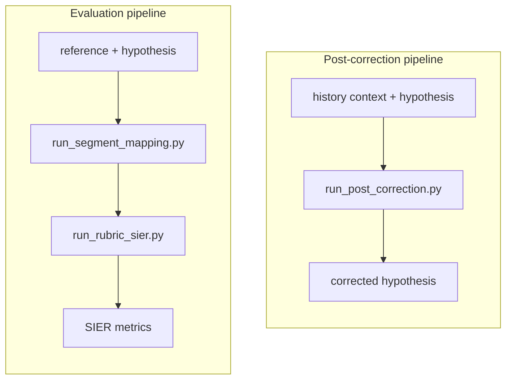

# Smart Pipeline

Smart Pipeline exposes four small Python entry points for ASR segment mapping,
rubric-based semantic evaluation, SIER aggregation, and history-only post
correction.

[Chinese documentation](README.zh.md)

## Parallel Pipelines

The post-correction and evaluation pipelines are independent, first-class
components placed side by side at the repository root. The correction path
never receives the current utterance's reference; references are used only by
the offline evaluation path.

```text
smart-pipeline/
+-- post_correction/                  # post-correction implementation and prompt
+-- segment_mapping/                  # evaluation: reference/hypothesis alignment
+-- rubric-based/                     # evaluation: canonical rubric and inference
+-- sier_metrics/                     # evaluation: SIER metric aggregation
+-- run_post_correction.py            # pipeline 1: history-only correction
+-- run_segment_mapping.py            # pipeline 2a: segment mapping
+-- run_rubric_sier.py                # pipeline 2b: rubric inference + SIER
+-- run_evaluation.py                 # pipeline 2: end-to-end evaluation
+-- requirements.txt                  # runtime dependencies
+-- Dockerfile                         # reproducible container image
+-- .dockerignore                      # Docker build context exclusions
+-- docker/jieba-cache/.gitkeep        # writable cache mount seed
+-- README.md
`-- README.zh.md
```



## Installation

Use Python 3.10 or newer and install the shared dependencies:

```bash
python -m pip install -r requirements.txt
```

The rubric and post-correction calls use an OpenAI-compatible API. Set
`LLM_API_KEY` (or `OPENAI_API_KEY`) in the environment; keys are never read
from JSONL input or written to result files.

## Docker

The repository includes a Python 3.13 Docker configuration. Build the image
and run the dependency-free command-line checks with:

```bash
docker build -t smart-pipeline .
docker run --rm smart-pipeline run_segment_mapping.py --help
```

`PYTHON_BASE_IMAGE` can be overridden when an offline or locally cached Python
image is required:

```bash
docker build \
  --build-arg PYTHON_BASE_IMAGE=python:3.11-slim-bookworm \
  -t smart-pipeline .
```

Mount input and output directories when running a pipeline. API-backed
commands also need `LLM_API_KEY` or `OPENAI_API_KEY` passed with `--env`.

## Entry Points

### 1. Segment mapping

Input is UTF-8 JSONL with one object per line. The stable input schema is:

```json
{
  "id": "sample-001",
  "reference": "ground truth transcript",
  "hypothesis": "ASR transcript"
}
```

Run the deterministic alignment stage:

```bash
python run_segment_mapping.py \
  --input path/to/evaluation_input.jsonl \
  --output path/to/segment_mapping.jsonl
```

The stable output schema is:

```json
{
  "id": "sample-001",
  "reference": "ground truth transcript",
  "hypothesis": "ASR transcript",
  "mapping": {
    "mapped_reference": ["ground", "truth", "transcript"],
    "mapped_hypothesis": ["ground", "truce", "transcript"],
    "mapped_ops": ["==", "SS", "=="],
    "mer": 0.333333,
    "aligned": "..."
  },
  "error_segments": [
    {
      "segment_index": 1,
      "reference_segment": "truth",
      "hypothesis_segment": "truce",
      "op_segment": "SS",
      "modified_reference": "ground truce transcript"
    }
  ]
}
```

`mapped_*` arrays describe the complete alignment. `error_segments` contains
only substitution, insertion, and deletion segments. `modified_reference` is
the reference text with the selected hypothesis segment applied.

### 2. Rubric evaluation and SIER

The only distributed rubric is
`rubric-based/config/rubric_v1.json`. It defines the questions, allowed
answers, evidence rules, and deterministic aggregation for
`CONSEQUENTIAL`, `INCONSEQUENTIAL`, and `UNSCORABLE` results.

```bash
python run_rubric_sier.py \
  --input path/to/segment_mapping.jsonl \
  --rubric rubric-based/config/rubric_v1.json \
  --segment-output path/to/rubric_results.jsonl \
  --metric-output path/to/sier_metrics.json \
  --workers 4
```

The command sends only mapped error segments to the judge, writes normalized
per-segment labels, and calculates the authoritative `s_ser`, `c_ser`,
`c_ser2`, `w_ser`, and `w_mer2` variants. Failed or invalid inferences are
reported as `UNSCORABLE`.

The normalized per-segment output schema is:

```json
{
  "id": "sample-001",
  "segment_index": 1,
  "reference_segment": "truth",
  "hypothesis_segment": "truce",
  "op_segment": "SS",
  "label": "CONSEQUENTIAL",
  "is_semantic_error": true,
  "rubric_version": "v1.0.2",
  "items": {
    "G1": {
      "answer": "valid",
      "reason_code": "...",
      "confidence": 0.98,
      "evidence": []
    }
  },
  "change_types": []
}
```

`change_types` is retained for analysis and does not participate in the final
label aggregation.

The metric output schema is:

```json
{
  "utterances": 100,
  "total_target_chunks": 1200,
  "total_target_words": 1850,
  "error_spans": 140,
  "semantic_error_spans": 52,
  "sier": 4.333333,
  "variants": {
    "s_ser": 4.333333,
    "c_ser": 3.916667,
    "c_ser2": 4.083333,
    "w_ser": 3.135135,
    "w_mer2": 3.405405
  },
  "unscorable_segments": 2
}
```

`sier` is the `s_ser` value exposed as the primary metric; all authoritative
variants are retained in `variants`.

### 3. Post correction

Post-correction input must not contain `reference` or `target`:

```json
{
  "id": "sample-001",
  "history_context": "previous turns in the same session",
  "hypothesis": "current ASR output"
}
```

Run the history-only correction engine with the canonical prompt:

```bash
python run_post_correction.py \
  --input path/to/correction_input.jsonl \
  --output path/to/corrected.jsonl \
  --prompt post_correction/prompts/v1_1.json \
  --mode single \
  --workers 4
```

Use `--mode multi` for bounded iterative correction. Every output row records
the original and corrected hypothesis, stop reason, rounds, and seen states so
that edits can be audited.

The output schema is:

```json
{
  "id": "sample-001",
  "status": "ok",
  "original_hypothesis": "current ASR transcript",
  "corrected_hypothesis": "corrected transcript",
  "stop_reason": "no_candidates",
  "rounds": [],
  "seen_hypotheses": ["current ASR transcript"]
}
```

`rounds` contains the segment list, candidate errors, suggestions, verifier
decisions, applied edits, and rejected edits for each correction round.

### 4. End-to-end evaluation

`run_evaluation.py` invokes segment mapping followed by rubric inference and
SIER aggregation. It does not invoke post correction:

```bash
python run_evaluation.py \
  --input path/to/evaluation_input.jsonl \
  --output-dir path/to/evaluation_output \
  --rubric rubric-based/config/rubric_v1.json \
  --workers 4
```

The output directory contains:

```text
segment_mapping.jsonl
rubric_results.jsonl
sier_metrics.json
manifest.json
```

The manifest records the resolved input and rubric paths, model parameters, and
the paths of the three generated artifacts:

```json
{
  "created_at": "2026-01-01T00:00:00+00:00",
  "input": "/path/to/evaluation_input.jsonl",
  "rubric": "/path/to/rubric-based/config/rubric_v1.json",
  "model": "deepseek-v4-pro",
  "outputs": {
    "segment_mapping": "/path/to/evaluation_output/segment_mapping.jsonl",
    "rubric_results": "/path/to/evaluation_output/rubric_results.jsonl",
    "sier_metrics": "/path/to/evaluation_output/sier_metrics.json"
  }
}
```

To compare correction before and after, run post correction first, construct a
new evaluation JSONL using its `corrected_hypothesis`, and run this evaluation
entry point separately for the original and corrected hypotheses.

## Data Contract

- Batch input and intermediate records are UTF-8 JSONL.
- Dataset-level metrics and manifests are JSON.
- Public text fields are `reference` and `hypothesis`; the metric adapter uses
  its internal `target` and `pred` names only inside the temporary work area.
- `id` values must be unique within each input file.
- Output and cache paths are created on demand and should remain outside the
  source tree when running experiments.
