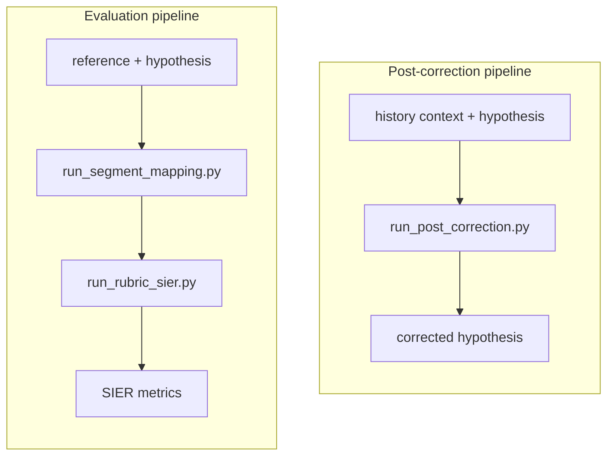

# Smart Pipeline

Smart Pipeline exposes four small Python entry points for ASR segment mapping,
rubric-based semantic evaluation, SIER aggregation, and history-only post
correction.

[Chinese documentation](README.zh.md)

## Parallel Pipelines

The post-correction and evaluation pipelines are independent, first-class
components placed side by side at the repository root. The correction path
never receives the current utterance's reference; references are used only by
the offline evaluation path.

```text
smart-pipeline/
+-- post_correction/                  # post-correction implementation and prompt
+-- segment_mapping/                  # evaluation: reference/hypothesis alignment
+-- rubric-based/                     # evaluation: canonical rubric and inference
+-- sier_metrics/                     # evaluation: SIER metric aggregation
+-- run_post_correction.py            # pipeline 1: history-only correction
+-- run_segment_mapping.py            # pipeline 2a: segment mapping
+-- run_rubric_sier.py                # pipeline 2b: rubric inference + SIER
+-- run_evaluation.py                 # pipeline 2: end-to-end evaluation
+-- requirements.txt                  # runtime dependencies
+-- README.md
`-- README.zh.md
```



## Installation

Use Python 3.10 or newer and install the shared dependencies:

```bash
python -m pip install -r requirements.txt
```

The rubric and post-correction calls use an OpenAI-compatible API. Set
`LLM_API_KEY` (or `OPENAI_API_KEY`) in the environment; keys are never read
from JSONL input or written to result files.

## Entry Points

### 1. Segment mapping

Input is UTF-8 JSONL with one object per line:

```json
{"id": "sample-001", "reference": "ground truth", "hypothesis": "ASR output"}
```

Run the deterministic alignment stage:

```bash
python run_segment_mapping.py \
  --input path/to/evaluation_input.jsonl \
  --output path/to/segment_mapping.jsonl
```

Each output row keeps the original texts, complete alignment arrays, and an
`error_segments` list for substitutions, insertions, and deletions.

### 2. Rubric evaluation and SIER

The only distributed rubric is
`rubric-based/config/rubric_v1.json`. It defines the questions, allowed
answers, evidence rules, and deterministic aggregation for
`CONSEQUENTIAL`, `INCONSEQUENTIAL`, and `UNSCORABLE` results.

```bash
python run_rubric_sier.py \
  --input path/to/segment_mapping.jsonl \
  --rubric rubric-based/config/rubric_v1.json \
  --segment-output path/to/rubric_results.jsonl \
  --metric-output path/to/sier_metrics.json \
  --workers 4
```

The command sends only mapped error segments to the judge, writes normalized
per-segment labels, and calculates the authoritative `s_ser`, `c_ser`,
`c_ser2`, `w_ser`, and `w_mer2` variants. Failed or invalid inferences are
reported as `UNSCORABLE`.

### 3. Post correction

Post-correction input must not contain `reference` or `target`:

```json
{
  "id": "sample-001",
  "history_context": "previous turns in the same session",
  "hypothesis": "current ASR output"
}
```

Run the history-only correction engine with the canonical prompt:

```bash
python run_post_correction.py \
  --input path/to/correction_input.jsonl \
  --output path/to/corrected.jsonl \
  --prompt post_correction/prompts/v1_1.json \
  --mode single \
  --workers 4
```

Use `--mode multi` for bounded iterative correction. Every output row records
the original and corrected hypothesis, stop reason, rounds, and seen states so
that edits can be audited.

### 4. End-to-end evaluation

`run_evaluation.py` invokes segment mapping followed by rubric inference and
SIER aggregation. It does not invoke post correction:

```bash
python run_evaluation.py \
  --input path/to/evaluation_input.jsonl \
  --output-dir path/to/evaluation_output \
  --rubric rubric-based/config/rubric_v1.json \
  --workers 4
```

The output directory contains:

```text
segment_mapping.jsonl
rubric_results.jsonl
sier_metrics.json
manifest.json
```

To compare correction before and after, run post correction first, construct a
new evaluation JSONL using its `corrected_hypothesis`, and run this evaluation
entry point separately for the original and corrected hypotheses.

## Data Contract

- Batch input and intermediate records are UTF-8 JSONL.
- Dataset-level metrics and manifests are JSON.
- Public text fields are `reference` and `hypothesis`; the metric adapter uses
  its internal `target` and `pred` names only inside the temporary work area.
- `id` values must be unique within each input file.
- Output and cache paths are created on demand and should remain outside the
  source tree when running experiments.
