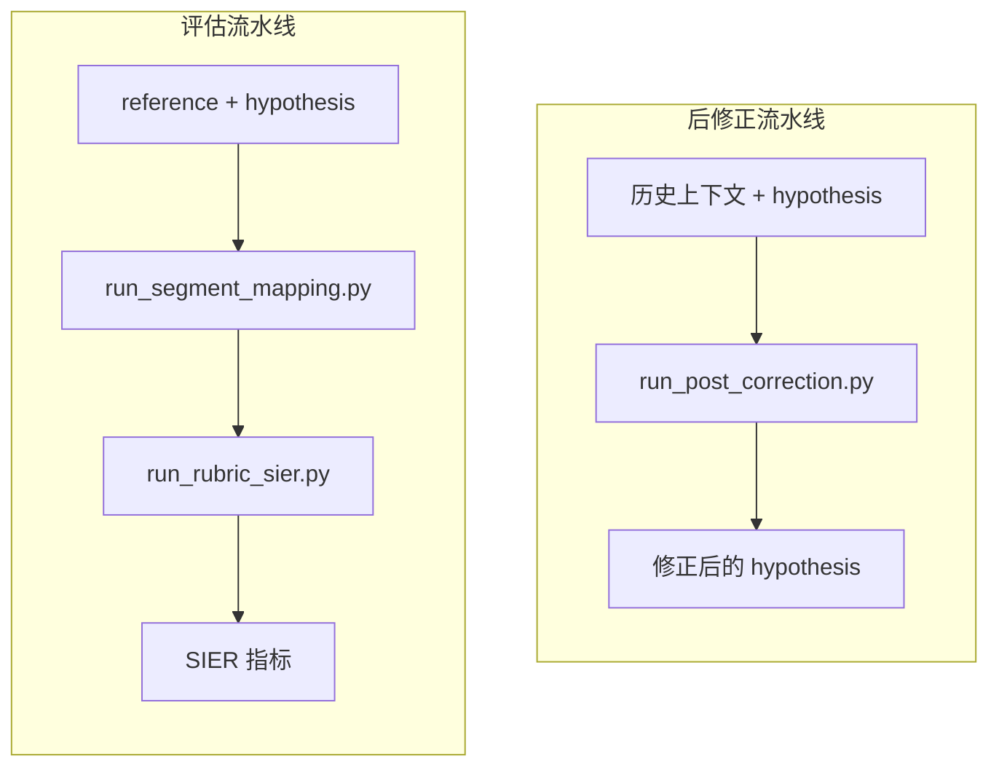

# Smart Pipeline

Smart Pipeline 提供四个 Python 入口，分别用于 ASR segment mapping、基于 rubric
的语义后果评估、SIER 指标聚合，以及只使用历史上下文的 ASR 后修正。

[English documentation / 英文文档](README.md)

## 并列的两条流水线

后修正流水线和评估流水线是相互独立、在仓库根目录并列的两个组件。后修正推理
不会接收当前句的 reference；reference 只进入离线评估流水线。

```text
smart-pipeline/
├── post_correction/                  # 后修正实现和 prompt
├── segment_mapping/                  # 评估：reference/hypothesis 对齐
├── rubric-based/                     # 评估：唯一 rubric 配置和推理
├── sier_metrics/                     # 评估：SIER 指标聚合
├── run_post_correction.py            # 流水线 1：只使用历史的后修正
├── run_segment_mapping.py            # 流水线 2a：segment mapping
├── run_rubric_sier.py                # 流水线 2b：rubric 推理和 SIER
├── run_evaluation.py                 # 流水线 2：完整评估
├── requirements.txt                  # 运行依赖
├── README.md
└── README.zh.md
```



## 安装

使用 Python 3.10 或更高版本，并安装共享依赖：

```bash
python -m pip install -r requirements.txt
```

Rubric 和后修正调用 OpenAI 兼容 API。通过环境变量设置 `LLM_API_KEY`（或
`OPENAI_API_KEY`）；密钥不会从 JSONL 输入读取，也不会写入结果文件。

## 四个入口

### 1. Segment mapping

输入是 UTF-8 JSONL，每行一个对象：

```json
{"id": "sample-001", "reference": "参考文本", "hypothesis": "ASR 输出"}
```

运行确定性的对齐阶段：

```bash
python run_segment_mapping.py \
  --input path/to/evaluation_input.jsonl \
  --output path/to/segment_mapping.jsonl
```

每条输出保留原文本、完整对齐数组，以及包含替换、插入和删除的
`error_segments`。

### 2. Rubric 评估与 SIER

仓库只分发一个 rubric：`rubric-based/config/rubric_v1.json`。它定义问题、可选答案、
证据规则，以及 `CONSEQUENTIAL`、`INCONSEQUENTIAL` 和 `UNSCORABLE` 的确定性聚合规则。

```bash
python run_rubric_sier.py \
  --input path/to/segment_mapping.jsonl \
  --rubric rubric-based/config/rubric_v1.json \
  --segment-output path/to/rubric_results.jsonl \
  --metric-output path/to/sier_metrics.json \
  --workers 4
```

命令只把对齐后的错误 segment 发送给 judge，写出逐 segment 的标准化标签，并计算权威
的 `s_ser`、`c_ser`、`c_ser2`、`w_ser` 和 `w_mer2` 变体。失败或无效的推理会记录为
`UNSCORABLE`。

### 3. 后修正

后修正输入不能包含 `reference` 或 `target`：

```json
{
  "id": "sample-001",
  "history_context": "同一会话中当前句之前的文本",
  "hypothesis": "当前 ASR 输出"
}
```

使用唯一的 canonical prompt 运行只依赖历史的后修正引擎：

```bash
python run_post_correction.py \
  --input path/to/correction_input.jsonl \
  --output path/to/corrected.jsonl \
  --prompt post_correction/prompts/v1_1.json \
  --mode single \
  --workers 4
```

使用 `--mode multi` 可启用有上限的多轮修正。每条输出记录原始和修正后的 hypothesis、
停止原因、各轮 trace 以及见过的状态，便于审计。

### 4. 完整评估

`run_evaluation.py` 依次调用 segment mapping、rubric 推理和 SIER 聚合，不调用后修正：

```bash
python run_evaluation.py \
  --input path/to/evaluation_input.jsonl \
  --output-dir path/to/evaluation_output \
  --rubric rubric-based/config/rubric_v1.json \
  --workers 4
```

输出目录包含：

```text
segment_mapping.jsonl
rubric_results.jsonl
sier_metrics.json
manifest.json
```

如需比较修正前后的效果，先运行后修正，再用其 `corrected_hypothesis` 构造新的评估
JSONL，分别对原始和修正后的 hypothesis 运行完整评估。

## 数据约定

- 批量输入和中间结果使用 UTF-8 JSONL。
- 数据集级指标和 manifest 使用 JSON。
- 对外字段为 `reference` 和 `hypothesis`；指标适配器只在临时工作目录内部使用
  `target` 和 `pred`。
- 每个输入文件中的 `id` 必须唯一。
- 运行时按需创建输出和缓存目录，实验结果应放在源码目录之外。
